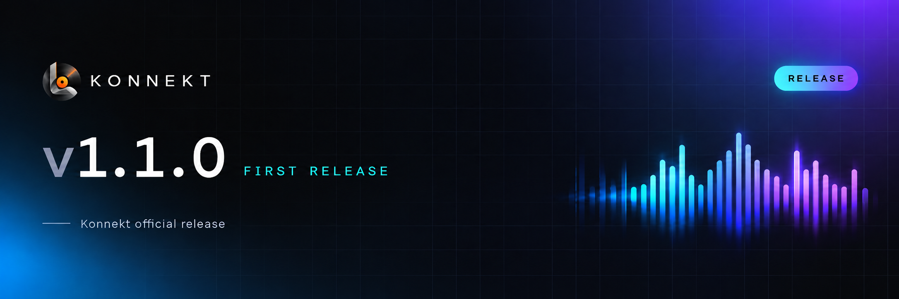

# 🎵 Konnekt Changelog

## 1.3.4 — Smoother lyrics, better discovery & updates in Konnekt

### 🎤 Lyrics that arrive sooner

- Show the first usable lyrics while the search continues for richer timing; manually selected providers stay selected.
- Prefer genuine syllable timing over word timing and line timing when richer synchronization is available.
- Start providers that do not need a recording identifier immediately, alongside the ISRC lookup.
- Collect provider results as they finish instead of waiting behind a slower provider in the priority list. Equal-quality results still use the configured source order.
- Share identical HTTP requests between the playback service and the lyrics screen, with a bounded five-minute memory cache for small successful responses.
- Cancel unused network requests when tracks change. Cancelling one reader keeps a shared request alive for another reader that still needs it.
- Enable the syllable-priority setting by default for installations that have no saved preference.

### ✨ A lighter lyrics screen

- Build a timestamp index once per song, then use binary search to find the current lyric instead of scanning the whole song every display frame.
- Preserve overlapping lead and backing vocals, repeated timestamps and backward seeking.
- Respect reduced animation when following the current line, and remove lyric blur in that mode.

### 🎧 Discovery that follows your listening

- Add a **Made for you** shelf based on two different artists from this month’s listening history.
- Interleave related discoveries, exclude tracks already in that history, remove duplicate tracks and limit each artist to two suggestions.
- Preserve the recommendation order supplied by the music service. Sections and tracks no longer reshuffle whenever another response arrives.
- Give home sections stable list keys so inserting a section preserves the identity of existing carousels.
- Cache a bounded home preview separately for each account/channel and language. Launches can show the cached feed while fresh content loads; offline launches can keep that preview.

### 📦 Updates without a GitHub detour

- Check GitHub Releases when Konnekt opens or returns to the foreground, with one coordinated request and a short cooldown.
- Show a redesigned native update dialog with the Konnekt logo, release notes, theme-aware colors and a brief entrance animation that respects reduced animation.
- Download the appropriate APK directly in Konnekt. Recognize names such as `arm64`, `arm64-v8a` and `aarch64`, and reject incompatible CPU builds and debug/unsigned assets.
- Display download progress, a separate verification state and translated recovery messages. Downloads continue when the dialog is dismissed.
- Keep completed downloads between launches and validate them again before offering installation.
- Check file size, SHA-256 when GitHub supplies it, package identity, release version, higher Android version code and signing compatibility.
- Open Android’s installer from Konnekt. If installation permission is needed, continue after returning from the Android permission screen.
- Translate the new dialog messages and discovery labels into all **16 supported languages**. Release notes retain the language used by their author on GitHub.

### 🖤 Unified Konnekt identity

- Renamed source packages, JNI bindings, resource names, native libraries, desktop packaging and CI references to Konnekt.
- Added a new English README, a folder guide, refreshed K artwork and consistent repository/service links.
- Kept Android storage names and release signing identity; added migration of one compatible desktop preference store.
- Preserved word-timed embedded lyrics when reading files saved with an earlier metadata namespace, and made new lyric tags consistent across containers.
- Completed missing cloud-account, theme and Replay messages in 14 translations; all 16 interface locales now pass the resource checks.

### 🔧 Release & validation

- Removed the unfinished custom Cast receiver changes; the existing Cast implementation remains available.
- Fixed stale namespace imports in Android Studio’s debug previews.
- Added regression coverage for APK selection, version comparison, discovery diversity, shared lyric requests, cancellation and lyric focus.
- Performance changes target specific sources of waiting and repeated work; no device speed multiplier is claimed.

**Android version:** `1.3.4` · **versionCode:** `13006` · **Package:** `com.music.konnekt`

---
## 1.3.3 — Replay restored, a fresh Konnekt look

### 🎬 Replay that opens and plays

- Fixed the app closing immediately after tapping **Play your Replay** in Library. The story header now loads a supported PNG asset instead of an Android XML bitmap wrapper.
- Unmounts the Replay overview while its full-screen stories are open, reducing the amount of interface held in memory during playback.
- Keeps the colorful story cards, progress segments, tap navigation, listening charts, and share flow shown in the reference Replay.

### 💿 Your listening history

- Replay continues to count listening on this device and keeps its records through an in-place update from a release signed with the same certificate.
- A fresh installation starts with fresh local statistics. Restoring a Konnekt backup can bring back earlier listening history; updating the APK alone cannot recreate records removed by an uninstall.

### 🎨 New Konnekt icon

- Replaced the Android launcher and Play Store artwork with the supplied glossy black **K** on a soft gray background.
- Added the supplied white and black transparent K variants to the interface: white on dark Replay cards, black on light Home backgrounds, and white on dark Home backgrounds.
- Updated the small icon used by playback, download, and cloud notifications to the new K, so the notification center matches the launcher.

### 📦 Release details

- Built and signed arm64 and universal APKs. Both keep the `com.music.konnekt` package and the release signing certificate used by 1.3.2.
- Verified the APK manifest, higher version code, signature, and ZIP alignment before delivery.

**Android version:** `1.3.3` · **versionCode:** `13004` · **Package:** `com.music.konnekt`

---

## 1.3.2 — Your music, your account

### ☁️ Konnekt account

- Create a Konnekt account with a username and password; no email address or confirmation is required.
- Save playlists, settings and connected account sessions to Supabase in an encrypted backup. Restore them on another device when you choose.
- Keep the cloud session locally across in-place app updates; changes to playlists, settings and connected accounts sync after the first cloud save.

### 🎨 Polish & motion

- Switched the launcher icon to the supplied `Logo.png` artwork.
- Added **Midnight** and **Ember** themes alongside the existing appearance options.
- Added brief feedback to song overflow buttons and showed the beat-linked player animation throughout Automix transitions. Reduced-motion settings remain respected.

### 📦 Downloads & updates

- New audio downloads default to the reusable `Music/Konnekt` folder. Existing download records stay in place when updating.
- In-app updates prefer the APK matching the device's processor and check the downloaded package, version and signer before installation.
- Added a release check for package identity, increasing version code, signing continuity and APK alignment.

**Android version:** `1.3.2` · **versionCode:** `13002` · **Package:** `com.music.konnekt`

---

## 1.3.1 — Replay reliability

### 🛠️ Replay fixes

- Reduced the memory used when opening Replay from Library by replacing the full-screen blurred backdrop with an artwork-coloured gradient.
- Kept a stable listening summary throughout a Replay story, even while artist details update in the background.
- Serialized story navigation so repeated taps on a Replay card cannot start overlapping page changes.
- Added a clear error message and **Retry** action if listening history cannot be loaded.

**Android version:** `1.3.1` · **versionCode:** `13001` · **Package:** `com.music.konnekt`

---

## 1.3.0 — Smoother listening

### ✨ Interface & motion

- Added short, directional transitions when switching tabs and opening the Library grid.
- Kept the outgoing page visible during tab transitions to avoid a brief dark flash.
- Respected the **Reduce animations** setting throughout these transitions.

### 🛠️ Fixes

- Hardened Replay against duplicate chart keys, which could crash the app with certain listening histories.
- Made Replay land on the right chart after its listening summary changes.
- Updated the Settings footer links to [Konnekt on GitHub](https://github.com/Lokal-Konnekt/Konnekt) and [Tysnnn23](https://github.com/Tysnnn23). Removed the outdated Discord and Website links.

### ⚡ Performance

- Reused recently found lyrics when returning to a song, avoiding another provider lookup.
- Allowed canvas lookups for different songs to run independently, so an older request cannot hold up the current song.

**Android version:** `1.3.0` · **versionCode:** `13000` · **Package:** `com.music.konnekt`

---

## 1.1.0 — First release

Konnekt brings streaming, local music, and configurable sources together in a customizable Android music player.

### 🎧 Highlights

- Search and play music through YouTube Music, your local audio library, and additional configurable sources.
- Enjoy background playback, offline downloads, crossfade, gapless playback, and a sleep timer.
- Follow synchronized lyrics in an interface that adapts to album artwork.
- Adjust audio quality for each network, playback speed, and the equalizer; inspect stream details when you want them.
- Connect Google and Spotify playlists, scrobble with Last.fm or ListenBrainz, and use Discord Rich Presence.
- Listen with friends through Listen Together.

Some features require an account, a configured source, or an external service.

### Version details

- Android version: `1.1.0` (`versionCode` 11000).
- Application ID: `com.music.konnekt`.
- Distributed under [GPL-3.0](LICENSE), with original author notices retained in the source.
