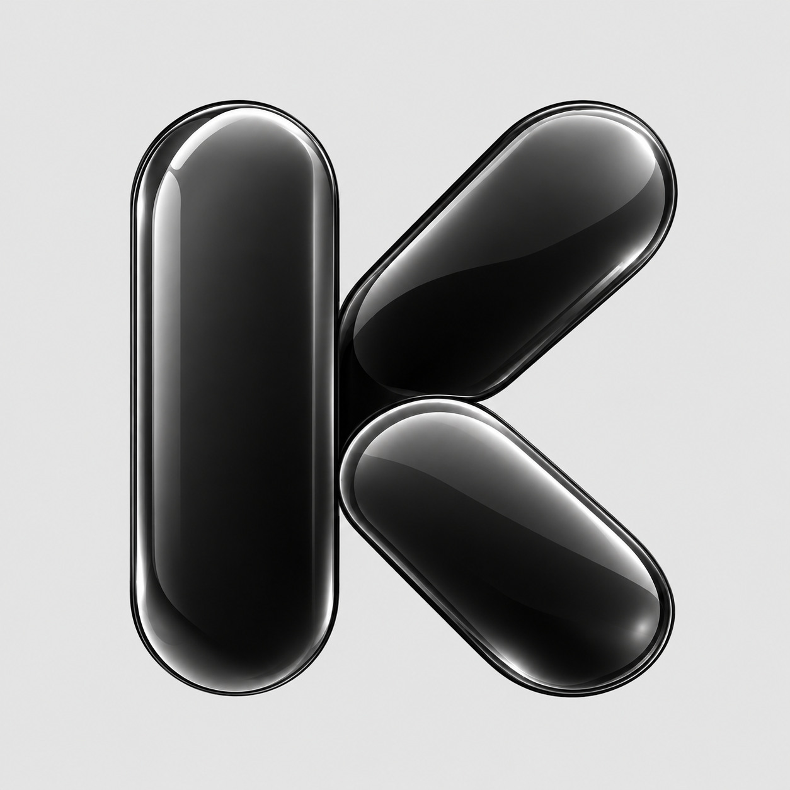

<div align="center">


# Konnekt

**Your music. Your rhythm. Your space.**

An Android music player with syllable-synced lyrics, personalized discovery,
offline listening and a customizable player.

[Download](https://github.com/Lokal-Konnekt/Konnekt/releases/latest) · [Changelog](CHANGELOG.md) · [Issues](https://github.com/Lokal-Konnekt/Konnekt/issues) · [Contribute](CONTRIBUTING.md)

**Android 8.0+ · Kotlin Multiplatform · GPL-3.0**
</div>

---

## 🎧 Your music, in one place

Konnekt brings YouTube Music discovery, your local library and configurable music sources into one player. Listen in the background, build playlists, save tracks for offline playback and follow lyrics as they are sung.

The repository includes the Android app, shared Kotlin modules, a Windows/Linux desktop client and the Listen Together server. Android is the main release described here; desktop package availability depends on the assets published with each release.

## ✨ Features

| | What you can do |
|---|---|
| **Discover** | Search tracks, albums and artists; browse a personalized feed and discover related music based on your listening. |
| **Listen** | Background and lock-screen playback, queue management, shuffle, repeat, sleep timer, gapless playback, crossfade and Automix. |
| **Follow the lyrics** | Syllable, word and line sync, multiple providers, source selection, timing adjustment, translation, romanization and lyric sharing. |
| **Go offline** | Download music, browse local audio and keep downloads across compatible app updates. |
| **Make it yours** | Light/dark appearance, Midnight and Ember themes, artwork colors, Canvas artwork and reduced animation/blur options. |
| **Explore Replay** | Listening time, favorite tracks and artists, Replay stories and shareable summaries. |
| **Connect** | Google/YouTube Music accounts, Spotify playlists, Discord Rich Presence, Last.fm, ListenBrainz and Listen Together. |
| **Keep your setup** | A username/password Konnekt account and encrypted cloud backup of playlists, settings and connected account sessions. Audio files stay on the device. |
| **Tune playback** | Quality choices, playback speed, equalizer, output options, stream diagnostics and local formats including DSD. |
| **Stay up to date** | A localized update dialog, APK download inside Konnekt and installation through Android’s installer. |

Availability depends on the music source, provider, device and account. Cloud backup needs the configured Supabase service; Listen Together needs its backend. Rich lyric timing requires a provider that has published it for the recording.

## 📲 Install

1. Open [GitHub Releases](https://github.com/Lokal-Konnekt/Konnekt/releases/latest).
2. Choose the **arm64 APK** for a compatible phone, or the **universal APK** for broader CPU support.
3. Open the APK and allow installation from the source Android identifies.
4. Future stable releases with a compatible APK can be downloaded from Konnekt’s update dialog.

**Requires Android 8.0 (API 26) or newer.** Keep the existing app installed when updating. The same package and a compatible signature allow an update in place; uninstalling removes app-private data.

Android application ID: `com.music.konnekt`. Builds signed with another key cannot update an official installation.

## 🌍 Languages

The Android interface supports **16 languages**: English, French, German, Spanish, Hebrew, Hindi, Indonesian, Italian, Japanese, Polish, Portuguese, Russian, Thai, Turkish, Vietnamese and Chinese. Update labels and errors are localized; release notes retain their author’s language.

## 🧩 Project structure

| Folder | Purpose |
|---|---|
| [`app/`](app) | Android authentication, playback service, downloads, widgets, settings, Replay and JNI bindings. |
| [`shared/`](shared) | Models, music APIs, lyric providers, source matching, audio analysis and synchronization protocols. |
| [`sharedUi/`](sharedUi) | Shared Compose screens, player, lyrics, themes, icons and translations. |
| [`desktopApp/`](desktopApp) | Windows/Linux client, playback, persistence, native integration and packaging. |
| [`native/`](native) | Shared C/C++ audio analysis and processing. |
| [`backend/`](backend) | Go/WebSocket Listen Together and presence service, deployment templates and tests. |
| [`supabase/`](supabase) | Cloud backup database migrations. |
| [`docs/`](docs) | Technical guides and release documentation. |
| [`tools/`](tools) | APK verification and branding audit tools. |
| [`.github/`](.github) | CI, packaging and deployment workflows. |

See the [folder-by-folder guide](docs/PROJECT_STRUCTURE.md).

## 🛠️ Build Android

Use **JDK 17**, Android **SDK platform 37**, **NDK 26.3.11579264**, **CMake 3.22.1** and the included Gradle wrapper. The app targets API 36.

Set the SDK path in the gitignored `local.properties`, or use `ANDROID_HOME`/`ANDROID_SDK_ROOT`:

```properties
sdk.dir=/absolute/path/to/Android/Sdk
```

```bash
# Development APK: installs separately from production
./gradlew :app:assembleDevDebug

# Production APKs
./gradlew :app:assembleProdRelease
```

On Windows, replace `./gradlew` with `.\gradlew.bat`.

Release signing reads `keystore.properties`; use [the example](keystore.properties.example) as a template. Keep the existing release key for official updates. Outputs are under `app/build/outputs/apk/`, with CPU-specific and universal APKs.

### Optional services

| Configuration | Purpose |
|---|---|
| `LASTFM_API_KEY`, `LASTFM_SECRET` | Last.fm authentication and related features. |
| `LISTEN_TOGETHER_SERVER` | Group-listening backend HTTP(S) address. |
| `SUPABASE_URL`, `SUPABASE_PUBLISHABLE_KEY` | Android cloud account and backup deployment. |
| `MODULE_INDEX_URL` | Default desktop music-source index. |

Keep signing material, tokens and private credentials out of commits. Service access also depends on deployed authentication and database policies.

## 🖥️ Desktop & backend

Desktop uses **Java 21** and Compose Multiplatform. See [DESKTOP.md](DESKTOP.md) for native audio and packaging requirements.

```bash
./gradlew :desktopApp:run
```

The server uses the Go version declared in `backend/go.mod`. See [backend/README.md](backend/README.md) for deployment and configuration.

```bash
cd backend
go test ./...
go run .
```

## 🧪 Checks & releases

```bash
./gradlew :shared:jvmTest :sharedUi:jvmTest :app:testProdDebugUnitTest
./gradlew :desktopApp:test
```

Verify APK package, version, signature and alignment with [verify-release.ps1](tools/verify-release.ps1). Follow the [update publishing guide](docs/IN_APP_UPDATES.md).

## 🤝 Contributing

Report the app version, Android version, device model and reproduction steps with each bug. Remove private tokens from shared logs. Read [CONTRIBUTING.md](CONTRIBUTING.md), the [Code of Conduct](CODE_OF_CONDUCT.md) and [MAINTAINERS.md](MAINTAINERS.md).

## 📄 License

Konnekt is distributed under the [GNU GPL v3](LICENSE). Third-party components retain their copyright and license notices in the source tree.

Konnekt is an independent client, unaffiliated with YouTube, Google, Spotify or Discord. It does not host music; connected services and sources retain their own availability and terms.
